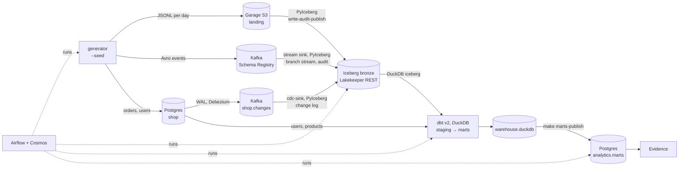

# clickstream-lakehouse

[](https://github.com/jjabuk/clickstream-lakehouse/actions/workflows/ci.yml)

A lakehouse that runs on a laptop, built on the synthetic clickstream and orders of a web shop.
A deterministic generator plays one day at a time, with the dirt of real data: late events,
duplicates, bots, skewed clocks, a schema change, devices that log in halfway through a visit.
The days reach Iceberg three ways (files, a Kafka stream, CDC from Postgres), are modelled by dbt
into a Kimball star with a semantic layer, run in Airflow, and end on an Evidence dashboard.

It is an analytics engineering project on a data engineering base. The base is tested, not
only drawn: every guarantee below is checked by a test or a CI step, and many of them break the
pipeline on purpose. Every choice has an ADR with the alternatives it rejected.

## What it shows

**Analytics engineering**

- **A Kimball star with the hard parts.** Sessions are built in SQL, incrementally, with a
  lookback window for late events (ADR 0004). `dim_user` is SCD2. `fct_orders` is an
  accumulating snapshot built from a change log, with a timestamp per milestone that the source
  table has already overwritten (ADR 0007).
- **Identity stitching.** A cookie that one user logs in on is that user's device,
  retroactively. A shared computer is left unknown rather than guessed. Retention counts people,
  not cookies (ADR 0022).
- **A semantic layer** in dbt, next to the marts. Evidence restates the metrics it shows, and CI
  checks day by day that both give the same numbers (`make ci-metrics`, ADR 0023).
- **Contracts and versions.** Every mart has an enforced contract. A breaking change is a new
  model version with a deprecation date, and CI fails a pull request that breaks a contract
  without one (ADR 0025).
- **Tests at three levels:** unit tests for the tricky SQL (session gaps, late events, the SCD2
  join, the funnel, milestones, stitching), data tests on every mart, and an incremental build
  that must equal a full refresh.

**Data engineering**

- **Iceberg with a REST catalog** (Lakekeeper on Garage S3). PyIceberg writes and DuckDB reads
  (ADR 0001 to 0003). [Schema and partition evolution, time travel, compaction and snapshot
  expiration](docs/iceberg-operations.md) were run on the real table, each with a query before
  and after.
- **Write-audit-publish on Iceberg branches.** A day is written to a branch and audited, and
  only then is `main` fast-forwarded. A broken delivery stays on its branch (ADR 0008).
- **A Kafka stream with exactly-once into Iceberg.** A small sink of its own commits the Kafka
  offsets in the Iceberg snapshot, with Avro and the Schema Registry. Failure tests kill the
  sink, race two of them and run maintenance mid-window, and nothing is lost or written twice
  (ADR 0005, 0006, 0021). The marts built from the stream equal those built from files.
- **CDC with Debezium.** The shop's orders come from Postgres's WAL as a change log. A watermark
  ends each day, so dbt never builds on a half-captured one. A test replays the log and gets the
  shop's rows back (ADR 0007).

**Operations**

- **Airflow** replays simulated days as backfills, with Cosmos running dbt (ADR 0017).
- **An SLA on two clocks:** the marts' freshness against the simulated clock, and a run's
  deadline against the wall clock. Alerts land in one table, which the dashboard shows
  (ADR 0026).
- **CI** runs the whole stack in GitHub Actions. A pull request gets a slim build of what it
  changed, deferred to `main`, or a full replay of four days across the schema change
  (ADR 0015).

## Architecture



- **The clickstream** reaches `bronze.clickstream_events` one of two ways, as files
  (`make day`, the default) or as a stream (`make stream-day`). dbt cannot tell which.
- **The orders** always come through CDC into `bronze.shop_changes`. Users and products are read
  from Postgres directly, with users snapshotted as SCD2 (ADR 0014).
- **dbt v2** builds staging, intermediate and marts into one DuckDB file (ADR 0013, 0024).
  Evidence reads a Postgres copy of the marts, swapped in one transaction after each build
  (ADR 0018).

## Data model

| Model | Grain |
|---|---|
| `fct_page_views` | one human page view (`event_id`); incremental merge with a lookback window |
| `fct_sessions` | one session: a cookie's page views without a gap longer than the timeout, with the identified user and `person_id` |
| `fct_funnel_daily` | day × device × campaign; counts of the ordered steps product → cart → checkout |
| `fct_retention_weekly` | cohort week × activity week; people (stitched users, or cookies) by first visit |
| `fct_traffic_daily` | day × human/bot; what bot filtering removes |
| `fct_visitor_conversion_daily` | visitor × day with a product view; checkout within 7 days in any session, with a flag for windows still open |
| `fct_orders` | one order, an accumulating snapshot from the change log: current status, a timestamp per milestone, revenue |
| `fct_order_status_changes` | one status an order entered, with the time spent in the one before |
| `dim_user` | one version of a registered user (SCD2), plus an "unknown" member |
| `dim_page`, `dim_date` | one page URL; one calendar day |

## Quickstart

Requirements: Docker, [uv](https://docs.astral.sh/uv/), DuckDB 2.0.0 as a system library
(Homebrew's `duckdb` on macOS, `make libduckdb-install` on Linux; dbt v2 uses it, ADR 0024), and
the `/etc/hosts` entry `127.0.0.1 garage` (ADR 0012; `make hosts-check` tells you).

```bash
make setup                   # Python dependencies from uv.lock, git hooks
make bootstrap               # the stack: storage, catalog, Postgres, Kafka, Debezium
make day DATE=2026-01-10     # one simulated day: clickstream through WAP, orders through CDC
make dbt-build
make marts-publish
make evidence-install && make evidence-dev
```

The dashboard is at http://localhost:3000. With Airflow (`make airflow-up`, UI at
http://localhost:8088), days are replayed with `make airflow-backfill FROM=2026-02-01
TO=2026-02-07`. A broken delivery is `make day DATE=... FAULT=truncated` (or `make airflow-day
DAY=... FAULT=truncated`). Devices and logins in the middle of a visit start on 2026-03-01, so
stitching shows from there on. `make help` lists every command.

### Through Kafka

```bash
make stream-up
```
```bash
make stream-day DATE=2026-01-11
```

Kafka itself runs in the core stack, for CDC: `make cdc-status` shows the Debezium connector and
its replication slot, `make cdc-changes` the latest changes in bronze. `make stream-up` adds the
Schema Registry, the clickstream's sink and Console.

Redpanda Console shows the topic, the decoded events and the schemas at http://localhost:8090.
`make stream-day DATE=... FAULT=duplicated` delivers a broken day: the audit rejects it, tags it
`rejected_YYYYMMDD` and resets the branch, and `main` does not change; the same command without
`FAULT` is the redelivery. In Airflow: `make airflow-day DAY=... INGEST=stream`.

## Limits, and the way to production

This is a demo on one machine, and some choices only make sense there:

- **DuckDB has a single writer.** One `dbt build` runs at a time, and a retried dbt task in
  Airflow needs the day run again (ADR 0017). A shared warehouse (Snowflake, BigQuery,
  Databricks SQL) removes this. Because the models are plain SQL, it would mean a new adapter and
  a few macros, not a rewrite.
- **Single-node services.** There is one Kafka broker, one Connect worker, and Garage with one
  node. Production would use managed Kafka and object storage. The exactly-once argument does not
  change, because it rests on the Iceberg commit, not on the broker.
- **Simulated time.** Freshness is measured against the generator's clock, which a real
  pipeline would replace with the wall clock (ADR 0026).
- **Secrets** come from a local `.env`. Production would use a secret manager, and Debezium
  already reads its credentials from the environment, not from its configuration.
- **Synthetic data.** It is generated with a seed and contains no real person. Stitching is
  checked against the generator's truth, which a real shop does not have.

## Repository layout

```
generator/      synthetic traffic, users, orders and faults
ingest/         files, stream and CDC into bronze; write-audit-publish; Iceberg maintenance
dbt/            staging, intermediate, marts, snapshots, tests
serving/        marts → Postgres for the dashboard; freshness and alerts
evidence/       Evidence pages and metrics
airflow/dags/   the daily DAG (Cosmos) and the alert callbacks
infra/          docker compose, Debezium connector, service configuration
tests/          unit tests, and integration tests on the running stack
ci/             CI checks (contracts, metrics, DAG import, slim or full); workflow in .github/workflows/
docs/adr/       architecture decision records
```

## Decisions

| ADR | Decision |
|---|---|
| [0001](docs/adr/0001-iceberg-instead-of-delta.md) | Iceberg instead of Delta |
| [0002](docs/adr/0002-rest-catalog-lakekeeper.md) | REST catalog: Lakekeeper |
| [0003](docs/adr/0003-pyiceberg-writes-duckdb-reads.md) | PyIceberg writes, DuckDB reads |
| [0004](docs/adr/0004-late-data-lookback-window.md) | Late data: a lookback window in dbt |
| [0005](docs/adr/0005-kafka-ingest-without-touching-dbt.md) | Kafka ingest without touching dbt, with a sink of our own |
| [0006](docs/adr/0006-avro-and-schema-registry.md) | Avro with the Schema Registry, BACKWARD compatibility |
| [0007](docs/adr/0007-cdc-as-a-change-log-in-bronze.md) | The shop's orders through CDC, kept in bronze as a change log |
| [0008](docs/adr/0008-write-audit-publish-on-iceberg-branches.md) | Write-audit-publish on Iceberg branches |
| [0010](docs/adr/0010-object-storage-garage.md) | Object storage: Garage |
| [0011](docs/adr/0011-separate-postgres-instances.md) | Separate Postgres instances for the shop and the platform |
| [0012](docs/adr/0012-single-s3-endpoint.md) | One S3 endpoint for every client |
| [0013](docs/adr/0013-marts-in-duckdb-file.md) | Marts in a DuckDB file, Iceberg for bronze |
| [0014](docs/adr/0014-users-read-from-postgres-directly.md) | Users read from Postgres directly (orders moved to CDC, ADR 0007) |
| [0015](docs/adr/0015-ci-slim-builds-and-incremental-replay.md) | CI: slim builds and incremental replay |
| [0016](docs/adr/0016-iceberg-table-maintenance-with-pyiceberg.md) | Iceberg maintenance with PyIceberg |
| [0017](docs/adr/0017-airflow-with-cosmos-watcher-mode.md) | Airflow with Cosmos in watcher mode |
| [0018](docs/adr/0018-evidence-studio-on-a-postgres-serving-copy.md) | Evidence on a Postgres copy of the marts |
| [0019](docs/adr/0019-stay-on-dbt-core-1-12-for-now.md) | Stay on dbt Core 1.12 until v2 runs elementary on DuckDB (superseded by 0024) |
| [0021](docs/adr/0021-write-audit-publish-for-the-stream.md) | Write-audit-publish for the stream |
| [0022](docs/adr/0022-identity-stitching.md) | Identity stitching: a cookie belongs to the one user who logs in on it |
| [0023](docs/adr/0023-semantic-layer-in-dbt-with-metricflow.md) | The semantic layer in dbt (MetricFlow) |
| [0024](docs/adr/0024-dbt-v2-without-elementary.md) | dbt v2, without elementary |
| [0025](docs/adr/0025-contracts-on-the-marts.md) | Contracts on the marts, with versions and a CI check |
| [0026](docs/adr/0026-sla-on-two-clocks.md) | An SLA on two clocks, and the alerts in one table |
