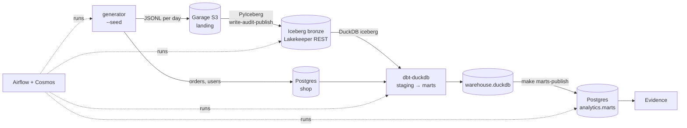

# clickstream-lakehouse

[](https://github.com/jjabuk/clickstream-lakehouse/actions/workflows/ci.yml)

A local lakehouse on the synthetic clickstream of a web shop. The generator simulates days of
traffic, orders and the dirt of real data: late events, duplicates, bots and schema changes. The
days are loaded into Iceberg through write-audit-publish, modelled with dbt into a Kimball star,
orchestrated by Airflow and shown in Evidence. All data is synthetic, and the generator is
deterministic (`--seed`).

## Architecture



- **Bronze** is the only Iceberg table (`bronze.clickstream_events`, partitioned by
  `day(server_ts)`). PyIceberg writes it and DuckDB reads it (ADR 0003, 0013).
- **Write-audit-publish.** Each arrival day is written to a branch `wap_YYYYMMDD` and audited:
  volume, duplicate deliveries, unknown event types and missing URLs. Only then is `main`
  fast-forwarded. A faulty batch stays on its branch and nothing downstream sees it (ADR 0008).
- **dbt v2** builds staging, intermediate and marts in a DuckDB file (ADR 0024). Incremental models merge with
  a lookback window for late events (ADR 0004). `dim_user` is SCD2 from a snapshot. Tests use
  dbt-utils, dbt-expectations and three tests of our own; the volume and freshness anomalies run
  on the simulated clock.
- **Airflow** replays simulated days with backfills. Cosmos runs one `dbt build` in watcher mode,
  because DuckDB has a single writer (ADR 0017).
- **Semantic layer** in dbt (MetricFlow): metrics are defined once next to the marts, and a test
  keeps the dashboard's definitions equal to them (ADR 0023). `make metrics-query
  METRICS=sessions,checkout_rate GROUP_BY=metric_time__week,user__plan`.
- **Evidence** reads a Postgres copy of the marts, swapped in one transaction after each build
  (ADR 0018).

Week by week, Kafka with Schema Registry, Debezium CDC and Feast come next. Stage 2 moves the same
dbt project to Databricks.

## Data model

| Model | Grain |
|---|---|
| `fct_page_views` | one human page view (`event_id`); incremental merge with a lookback window |
| `fct_sessions` | one session: a visitor's page views without a gap longer than the timeout |
| `fct_funnel_daily` | day × device × campaign; counts of the ordered steps product → cart → checkout |
| `fct_retention_weekly` | cohort week × activity week, cohorts by first visit |
| `fct_traffic_daily` | day × human/bot; what bot filtering removes |
| `fct_visitor_conversion_daily` | visitor × day with a product view; checkout within 7 days in any session, with a flag for windows still open |
| `dim_user` | one version of a registered user (SCD2), plus an "unknown" member |
| `dim_page`, `dim_date` | one page URL; one calendar day |

## Quickstart

Requirements: Docker, [uv](https://docs.astral.sh/uv/), DuckDB 2.0.0 as a system library
(Homebrew's `duckdb` on macOS, `make libduckdb-install` on Linux; dbt v2 uses it, ADR 0024), and
the `/etc/hosts` entry `127.0.0.1 garage` (ADR 0012; `make hosts-check` tells you).

```bash
make setup
```
```bash
make bootstrap
```
```bash
make day DATE=2026-01-10
```
```bash
make dbt-build
```
```bash
make marts-publish
```
```bash
make evidence-install
```
```bash
make evidence-dev
```

The dashboard is at http://localhost:3000. With Airflow (`make airflow-up`, UI at
http://localhost:8088), days are replayed with `make airflow-backfill FROM=2026-02-01
TO=2026-02-07`. A broken delivery is `make day DATE=... FAULT=truncated` (or `make airflow-day
DAY=... FAULT=truncated`). `make help` lists every command.

## Iceberg operations

Each operation was run on the dev table with real results. The queries are DuckDB with the
catalog attached as `lk`. The full walkthrough, including the files read and the CLI output, is
in [docs/iceberg-operations.md](docs/iceberg-operations.md). The design is in ADR 0016.

### Schema evolution: `utm_campaign` appears on 2026-02-01

The load adds the column with `union_by_name`. Older files are not rewritten and read it as NULL.

```sql
select cast(server_ts as date) as arrival_day, count(utm_campaign) as with_campaign
from lk.bronze.clickstream_events
where cast(server_ts as date) between '2026-01-31' and '2026-02-02'
group by all order by all;
```

| arrival_day | before 2026-02-01 was loaded | after |
|---|---|---|
| 2026-01-31 | *(no such column)* | 0 |
| 2026-02-01 | | 3264 |
| 2026-02-02 | | 2451 |

### Partition evolution: `day(server_ts)` → `hour(server_ts)`

`make iceberg-partition GRAIN=hour` changes only metadata. Old files stay in spec 0, and the
next day lands in spec 1 (`make iceberg-files`):

| arrival_day | spec_id | files | records | avg KiB |
|---|---|---|---|---|
| 2026-02-06 | 0 (day) | 1 | 8053 | 308 |
| 2026-02-07 | 1 (hour) | **24** | 8232 | **20** |

```sql
select count(*) from lk.bronze.clickstream_events
where server_ts >= '2026-02-07 10:00' and server_ts < '2026-02-07 11:00';
```

DuckDB prunes on both specs: one file for the hour of 2026-02-07 and the whole-day file for
2026-02-06. At ~8,000 rows a day, hourly files are too small, so bronze went back to `day`.

### Time travel: a day before its late events arrived

`make iceberg-time-travel DAY=2026-02-06` finds the snapshot after that day's load and before the
next one:

```sql
select cast(server_ts as date) as arrival_day, count(*) as events
from lk.bronze.clickstream_events at (version => 6993704786740758323)  -- drop AT for "now"
where cast(event_ts as date) = '2026-02-06'
group by all order by arrival_day;
```

| arrival_day | as of the snapshot | now |
|---|---|---|
| 2026-02-06 | 7870 | 7870 |
| 2026-02-07 | | **124** (late) |

### Compaction

`make iceberg-fragment DAY=2026-02-05 PARTS=24` simulates a streaming sink's small files, and
`make iceberg-compact` merges them: `24 -> 1 data files`. The rows are unchanged in both
directions:

```sql
select count(*) from (
  (select * from lk.bronze.clickstream_events
   except all select * from lk.bronze.clickstream_events at (version => 2564140707840797718))
  union all
  (select * from lk.bronze.clickstream_events at (version => 2564140707840797718)
   except all select * from lk.bronze.clickstream_events));
-- 0
```

### Snapshot expiration

```sql
select count(*) from iceberg_snapshots('lk.bronze.clickstream_events');  -- 42 before, 5 after
```

`make iceberg-expire KEEP=5` expired 37 snapshots. The time travel above now fails with
`Could not find snapshot with id 6993704786740758323`. PyIceberg deletes no files: the 3
unreferenced data files stay on S3.

### Write-audit-publish

```bash
make day DATE=2026-02-11 FAULT=truncated
```

The audit fails: 1,914 rows against a median of 8,053 for the previous days, where the floor is
50%. The batch
stays on `wap_20260211`, and `main` and the marts do not change. Delivering the day again without
the fault publishes it (`tests/integration/test_wap.py`).

## Repository layout

```
generator/      synthetic traffic, users, orders and faults
ingest/         landing → bronze (write-audit-publish), Iceberg maintenance, DuckDB reader
dbt/            staging, intermediate, marts, snapshots, tests
serving/        marts → Postgres for the dashboard
evidence/       Evidence pages and metrics
airflow/dags/   the daily DAG (Cosmos)
infra/          docker compose and service configuration
tests/          unit tests, and integration tests on the running stack
ci/             CI helpers (slim or full, replay); workflow in .github/workflows/
docs/adr/       architecture decision records
```

## Decisions

| ADR | Decision |
|---|---|
| [0001](docs/adr/0001-iceberg-instead-of-delta.md) | Iceberg instead of Delta |
| [0002](docs/adr/0002-rest-catalog-lakekeeper.md) | REST catalog: Lakekeeper |
| [0003](docs/adr/0003-pyiceberg-writes-duckdb-reads.md) | PyIceberg writes, DuckDB reads |
| [0004](docs/adr/0004-late-data-lookback-window.md) | Late data: a lookback window in dbt |
| [0008](docs/adr/0008-write-audit-publish-on-iceberg-branches.md) | Write-audit-publish on Iceberg branches |
| [0010](docs/adr/0010-object-storage-garage.md) | Object storage: Garage |
| [0011](docs/adr/0011-separate-postgres-instances.md) | Separate Postgres instances for the shop and the platform |
| [0012](docs/adr/0012-single-s3-endpoint.md) | One S3 endpoint for every client |
| [0013](docs/adr/0013-marts-in-duckdb-file.md) | Marts in a DuckDB file, Iceberg for bronze |
| [0014](docs/adr/0014-users-read-from-postgres-directly.md) | Users read from Postgres until CDC |
| [0015](docs/adr/0015-ci-slim-builds-and-incremental-replay.md) | CI: slim builds and incremental replay |
| [0016](docs/adr/0016-iceberg-table-maintenance-with-pyiceberg.md) | Iceberg maintenance with PyIceberg |
| [0017](docs/adr/0017-airflow-with-cosmos-watcher-mode.md) | Airflow with Cosmos in watcher mode |
| [0018](docs/adr/0018-evidence-studio-on-a-postgres-serving-copy.md) | Evidence on a Postgres copy of the marts |
| [0019](docs/adr/0019-stay-on-dbt-core-1-12-for-now.md) | Stay on dbt Core 1.12 until v2 runs elementary on DuckDB (superseded by 0024) |
| [0023](docs/adr/0023-semantic-layer-in-dbt-with-metricflow.md) | The semantic layer in dbt (MetricFlow) |
| [0024](docs/adr/0024-dbt-v2-without-elementary.md) | dbt v2, with our own anomaly tests instead of elementary |
